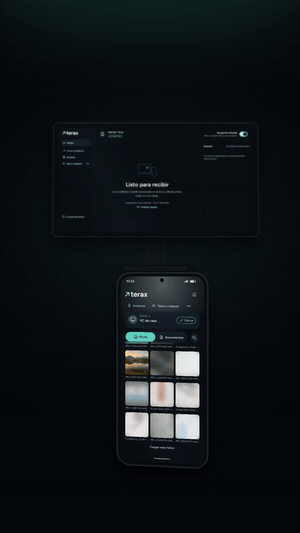
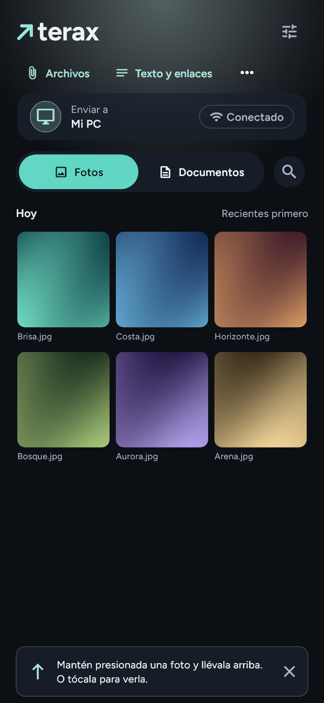
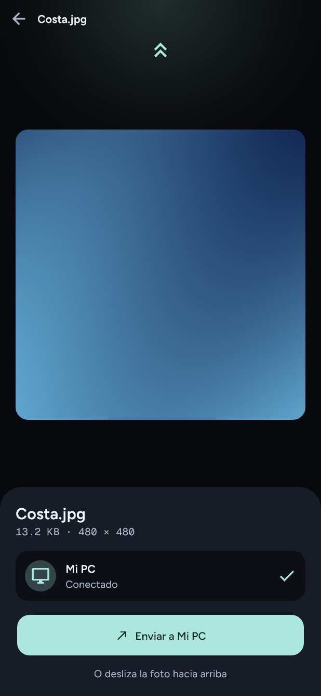
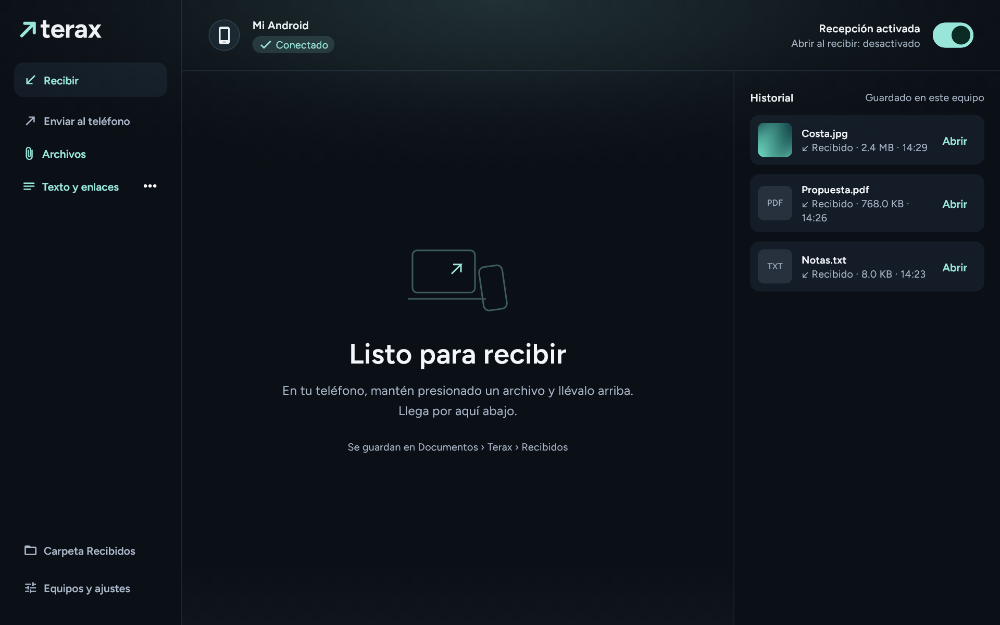

<p align="center">
  <picture>
    <source media="(prefers-color-scheme: dark)" srcset="assets/branding/terax-wordmark.svg">
    
  </picture>
</p>

<p align="center"><strong>Tus archivos. De un equipo al otro.</strong><br>Fotos, documentos, texto y enlaces entre Android y Windows, por tu red local.</p>

<p align="center">
  <a href="https://github.com/acid75/Terax/releases/tag/v0.5.4"></a>
  <a href="LICENSE"></a>
  
</p>

<p align="center">
  <a href="https://github.com/acid75/Terax/releases/download/v0.5.4/terax-android-arm64-0.5.4.apk"><strong>Descargar Android</strong></a> ·
  <a href="https://github.com/acid75/Terax/releases/download/v0.5.4/Terax-Windows-0.5.4.zip"><strong>Descargar Windows</strong></a> ·
  <a href="https://github.com/acid75/Terax/releases/tag/v0.5.4">Notas de la versión</a>
</p>

## Mira Terax en acción

<p align="center">
  <a href="https://github.com/acid75/Terax/releases/download/v0.5.4/terax-promo.mp4"></a>
</p>

<p align="center"><a href="https://github.com/acid75/Terax/releases/download/v0.5.4/terax-promo.mp4">Ver o descargar el video completo · 25 segundos</a></p>

## Qué puedes hacer

- Explorar fotos y carpetas dentro de Terax. Para archivos de **Descargas**, usar **Archivos**.
- Mantener presionado un archivo y llevarlo al borde superior, o abrir su vista previa y hacer **swipe hacia arriba**. También hay botón Enviar.
- Enviar y recibir desde Android o Windows, con el archivo saliendo y entrando por los bordes de la app.
- Compartir texto y enlaces; pegar y copiar mediante acciones explícitas. Abrir un enlace recibido requiere tocar su botón.
- Usar **Compartir → Terax** desde otras aplicaciones Android, incluso con varios archivos o texto adjunto.
- Añadir archivos a una cola secuencial, pausar, cancelar y reintentar. La cola conserva su destino al cambiar el equipo seleccionado.
- Consultar un historial local persistente. Borrar el historial conserva los archivos.
- Abrir automáticamente fotos y documentos compatibles en Windows, después de verificar su integridad, si activas esa opción.

## Capturas

<p align="center">
  
  &nbsp;&nbsp;
  
</p>

<p align="center"></p>

Las capturas corresponden a la interfaz real renderizada con archivos y equipos de demostración, sin datos personales. El video es una presentación promocional del flujo.

## Empezar

1. Instala Terax en Android y extrae el ZIP de Windows completo. Ejecuta `terax.exe` con las DLL y la carpeta `data/` a su lado.
2. Abre ambas apps en la **misma red Wi-Fi o LAN**. Si el firewall pregunta, permite el acceso en tu red privada.
3. Vincula los equipos **una vez**: en Android escanea el QR de Windows o pega el código de conexión. La autorización se guarda; no hace falta escanear en cada envío.
4. Elige una foto, un documento, texto o un enlace. Arrastra el archivo hacia arriba, desliza la vista previa o pulsa Enviar.
5. El receptor verifica el archivo antes de mostrar **Recibido y verificado**. Abre el resultado desde Terax o activa la apertura automática de archivos compatibles en Windows.

**Cercanía opcional:** permite dispositivos cercanos para usar Bluetooth LE. Solo estima proximidad; no inicia envíos por acercar el teléfono. Si Bluetooth no está disponible, puedes seguir transfiriendo por la red local.

**Permisos Android:** fotos y cámara se solicitan para sus funciones. La app solicita acceso a música/audio al primer arranque si falta; también puedes volver a solicitarlo en Ajustes. Los sonidos incluidos y los selectores de archivos no dependen de que autorices la lectura general de audio.

**Actualizar:** actualiza ambos equipos. En Windows, usa **bandeja → Salir** antes de reemplazar la versión anterior; cerrar la ventana deja la app funcionando. Instalar la actualización conserva la vinculación.

Los archivos recibidos se guardan en `Terax/Recibidos` dentro del directorio de documentos de la aplicación. En Android es una ubicación privada de la app: abre los archivos desde el historial.

## La versión 0.5.4

- Onda de transferencia sobre la interfaz en vivo: se repliega hacia el borde superior del emisor y se expande desde el borde inferior del receptor.
- Efecto **solo dentro de Terax**, sin capturas ni congelar el escritorio. El glow de conexión es independiente.
- Archivo con tamaño contenido y progreso en una franja inferior.
- Solicitud de permiso de música/audio dentro de Android.
- Sonidos distintos de salida y recibido, con interruptor para silenciarlos.

Esta es una **versión de pruebas** distribuida por GitHub. El APK ARM64 usa la firma de desarrollo y el ejecutable de Windows no incluye firma Authenticode. No es una publicación de tienda.

## Datos técnicos

| Aspecto | Implementación actual |
| --- | --- |
| Plataformas | Android 7/API 24 o posterior, ARM64; Windows x64 |
| Interfaz | Flutter/Dart, con integración Kotlin y C++/Win32 |
| Transporte | HTTPS en la red local; archivos transmitidos por streaming |
| Autorización | Vinculación por QR/código, huella TLS fijada y credenciales protegidas por el sistema |
| Integridad | SHA-256; el progreso al 100 % no sustituye la verificación |
| Reconexión | Descubrimiento LAN autenticado y actualización de dirección/puerto |
| Cercanía | Bluetooth LE y RSSI aproximado; no interviene en el transporte del archivo |
| Tamaño máximo | 1 GiB por archivo |
| Cola | Hasta 100 elementos, secuenciales y en primer plano; se pausa ante fallos |
| Historial | Hasta 50 transferencias verificadas, persistidas localmente |
| Apertura automática | Fotos admitidas hasta 32 MiB/40 MP y documentos compatibles hasta 64 MiB |
| Audio | MP3 local; SoundPool en Android y reproducción nativa MCI en Windows |
| Red externa | No utiliza nube, cuentas ni relay por internet |

### Límites importantes

- Android debe mantener Terax abierto durante las transferencias; no hay servicio receptor en segundo plano.
- La cola pendiente no se conserva al cerrar. No hay reanudación por fragmentos ni transferencias simultáneas dentro de una misma cola.
- Una red de invitados con aislamiento entre clientes puede impedir el descubrimiento y la conexión.
- La cercanía BLE depende de la radio, permisos, controladores y entorno. No detecta centímetros ni la posición física de la punta del teléfono.
- Textos y enlaces usan un formato de mensaje sobre el transporte de archivos existente. Actualiza ambos extremos para verlos como mensajes.
- No se abren ejecutables ni documentos con macros automáticamente. La opción de apertura conserva sus límites de tipo, tamaño y dimensiones.

## Compilar y colaborar

Entorno de referencia: **Flutter 3.44.4 / Dart 3.12.2**. Dependencias fijadas en `pubspec.lock`.

```sh
git clone https://github.com/acid75/Terax.git
cd Terax
flutter pub get
flutter analyze
flutter test
```

Windows requiere Visual Studio con herramientas de escritorio C++, ATL y Windows SDK. Android requiere su SDK, JDK 17 y licencias de desarrollo aceptadas.

```sh
# Windows
flutter run -d windows
flutter build windows --release

# Android ARM64
flutter build apk --release --target-platform android-arm64
```

Para distribuir una versión propia de Android, configura tu firma de distribución; no publiques keystores ni claves privadas. Usa las incidencias del repositorio para reproducibles y los pull requests para cambios acotados.

### Estructura

```text
lib/transfer/     HTTPS, integridad, identidad, descubrimiento, BLE, cola e historial
lib/sharing/      Mensajes, portapapeles explícito, compartir y sonidos
lib/ui/           Biblioteca, gestos, onda, estado de transferencia y ajustes
lib/theme/        Tokens y tema visual
android/          Puentes Kotlin y configuración Android
windows/          Integración C++/Win32 y bandeja
test/             Pruebas del transporte, contratos y presentación
docs/             Notas de implementación, verificación y medios públicos
```

**Verificación de 0.5.4:** 158 pruebas aprobadas, análisis sin incidencias y compilaciones release Android/Windows. Las pruebas y las capturas no sustituyen comprobar cámara, diálogo de permisos, Bluetooth, sonido y transferencia en dispositivos físicos.

## Licencia

El código original de Terax se publica bajo **[MIT](LICENSE)**, sin coste de licencia. Puedes usarlo, modificarlo y distribuirlo bajo sus condiciones. Las fuentes y demás recursos de terceros conservan sus propios avisos y condiciones; consulta **[THIRD_PARTY_NOTICES.md](THIRD_PARTY_NOTICES.md)**.
